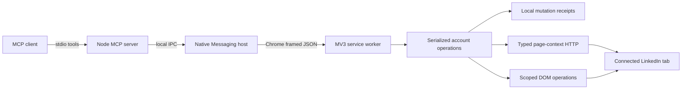

# Architecture

- `src/core/contracts.ts`: 33 strict input contracts, paired output schemas and a shared capability registry; no generic transport or browser tool.
- `src/core/engine.ts`: serialization, account checks, pagination, mutation journal, cancellation boundary and reconciliation.
- `src/core/api.ts`: typed routes, Rest.li variables and operation-specific response handling.
- `src/core/normalize.ts`: bounded normalized-reference resolution; missing collection is a schema error.
- `src/extension/background.ts`: native connection with bounded reconnect backoff, pause/disconnect, browser-side storage, cooldown and request pacing.
- `src/extension/work-tab.ts`: single-flight work-tab recovery, bounded loading and account verification; ephemeral tab IDs are not durable connection identity.
- `src/extension/page-fetch.ts`: browser authentication boundary and strict path allowlist.
- `src/extension/dom.ts`: bounded reads and scoped UI mutations.
- `src/native/`: framed native host, per-user socket, generated wire IDs and client transport.
- `src/installer.ts`: per-user macOS/Windows registration and launcher.

Pending receipt persistence happens before a write. An interrupted/pending receipt is replayed as unknown, never resent. Multiple MCP clients share one extension queue. A native host lock prevents two Chrome profiles from simultaneously owning the socket. Restarted sessions must still match the explicitly bound LinkedIn account before any operation.

No cloud runtime dependencies. Git installation supplies the local native host; the Chrome extension is distributed separately. Core operations do not own installation, workflows or CRM state.

## Platform boundary

`native/platform.ts` owns macOS/Windows paths and launcher syntax. macOS uses a private Unix socket. Windows uses a user-specific named pipe, with a random local token in a user-ACL-protected directory. The token is checked before dispatch and never forwarded to Chrome. Windows native-host registration is scoped to HKCU; neither installation requires administrator rights.

Builds expose the same 33 primitives with complete descriptions and common MCP server instructions. The runtime fingerprint binds acceptance to executable sources, dependencies, assets and build configuration rather than documentation commits. Store and development channels retain distinct native-host names.

## 0.3 adapter boundaries

API adapters own server cursor, timestamp and offset semantics. DOM adapters own a session in a dedicated work tab. The Engine only scopes, caches and budgets cursors and translates explicit adapter coverage into the public envelope. `capabilities.ts` owns adapter dispatch, output schemas and tool exposure; unavailable writes cannot be called through the production extension.

Conversation lookup is shared by public reads, exact recipient validation and mutation postconditions. State verification requests the necessary source fields instead of accepting a partial conversation entity. Delete verification scans mailbox membership, not still-readable historical messages. Message reconciliation follows older pages and can locate new-recipient conversations without dispatching again.

A connection-generation change invalidates queued operations and guards journal writes. In-flight external actions may still have taken effect; no retry is implied. Old pending receipts stay unknown. Storage schema revision 1 clears legacy temporary state without pausing an active connection. Release version changes do not imply schema changes. Explicit pause/disconnect is retained, as is the seven-day mutation journal.

## 0.4 direct writes

All 33 operations are exposed in every build. The approval module, review UI, inbox permission and test-write build flag have been removed. Writes retain account/target checks, serialization, durable receipts and postconditions. Acceptance metadata informs release readiness only. Migration clears session drafts and the old inbox preference without replaying actions or deleting the mutation journal; it preserves the bound connection and its explicit pause state. Local data clearing is available in the popup.

## 0.5 native post planning

The self-contained composer adapter owns native draft save/reopen, time confirmation, schedule listing and exact cancellation. It rejects immediate publish controls. The Engine binds schedule references to account, normalized text hash and timestamp, stores them without post bodies and expires them seven days after their scheduled time. Unknown planning receipts reconcile without redispatch. `post_create` is removed from the contract and executable adapter.

### Transient failure recovery

The client waits up to 35 seconds for a native-host socket, covering the extension's capped 30-second reconnect backoff. Health and registry-classified API reads can be replayed once after a transport disconnect, with identical arguments and a shared 70-second request deadline. DOM traversals and mutations are never replayed. Corrupted mutation responses retain unknown-outcome semantics.

Native-port ownership is part of operation cancellation. Requests queued on a dead port cannot run on its replacement, and API/DOM adapters recheck cancellation immediately before dispatch after pacing or navigation. A vanished tab between lookup and API GET injection gets one recovery attempt. Existing account, pause, receipt, and cursor protections remain in force. Reconnect does not wait behind receipt cleanup in the operation queue.

## Publishing identities

`account_urn` identifies the authenticated member; `actor_ref` identifies the
public author of one write. References are account-bound, expire after seven days
and resolve to observed profile/page URLs, names and avatar paths. They do not
select a global MCP context. A future multi-account router can select a browser
connection by account before invoking the same actor-aware operation. Each
connection must retain its own queue, cursors and account checks.

`comment_actors_list` reads managed-page identity links from the feed sidebar,
then intersects them with the native picker at the exact post. It does not change
the selected actor. The post detail omits managed-page links, so the bounded feed
read is necessary. Unresolved identities are omitted with `complete: false`.
No company URNs or page URLs are inferred from names, logos or DOM row keys.

The shared publishing-actor helper selects and verifies an actor for comments
and replies. The pre-dispatch proof and receipt retain the resolved author;
recovery does not depend on a current selection or an unexpired reference.
Omitting `actor_ref` explicitly selects the authenticated member. LinkedIn's
picker also affects reactions: `post_like` restores the personal actor when that
picker is present, preserving its existing personal-account contract.

The observed SDUI picker has an English title, native radio inputs, a Save/Cancel
pair and a post-level avatar switch. Avatar paths corroborate observed identity
links; names alone never authorize selection. Unknown picker layouts fail before
publication. A client may keep a preferred actor per chat, but must include its
reference in every write; the bridge has no shared `switch_context` operation.

Live inspection on 2026-11-11 found that the picker can initially contain only a
progress indicator. Discovery opens it once and waits up to eight checked polls
for the radio rows, respecting cancellation/deadline checks. The same inspection
found 100px picker and 200px sidebar `profile-displayphoto-scale` renditions with
the same media ID and upload timestamp but different rendition tokens. Only that
observed photo shape is normalized by asset ID and upload timestamp; different
uploads, media IDs and background images remain distinct. The native dialog is
closed with Cancel after listing, leaving its selected author unchanged.
